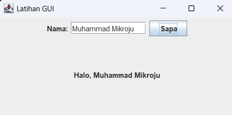

Nama : Muhammad Mikroju Raseprian Sahid
NIM  : F1D02410017

## Komponen GUI yang Digunakan

1. Top-level Container Class: JFrame
   Jendela utama program. Class Latihan mewarisi JFrame.

2. Intermediate Container Class: JPanel
   panelInput untuk kolom isian dan tombol, panelHasil untuk menampilkan hasil.

3. Atomic Component Class: 2 JLabel, JTextField, JButton
   JLabel untuk Label teks, JTextField untuk kolom isian nama, dan JButton untuk tombol Sapa.

4. Layout Classes: GridLayout dan FlowLayout
   GridLayout (2 baris, 1 kolom) untuk mengatur frame, FlowLayout untuk mengatur panel input.

5. Event Listener: ActionListener
   Method actionPerforme di override untuk menangani klik tombol.

## Cara Kerja
1. Pengguna mengetik nama pada JTextField.
2. Pengguna menekan tombol Sapa (JButton).
3. ActionListener menjalankan method actionPerformed.
4. Teks pada JLabel berubah menjadi Halo, nama.

## Screenshot Hasil

